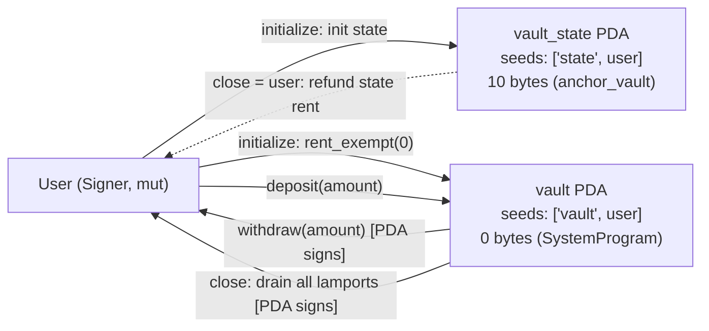
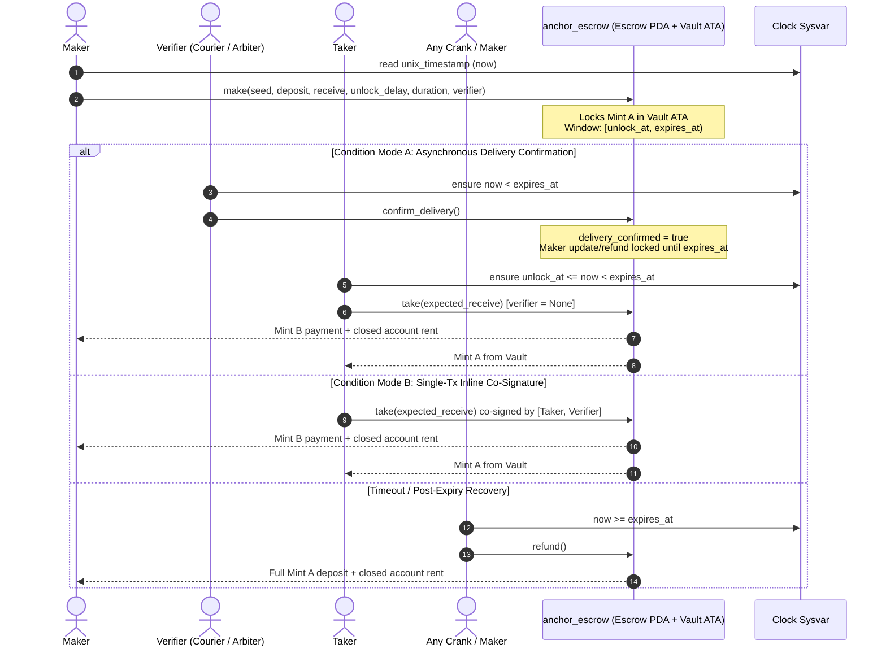
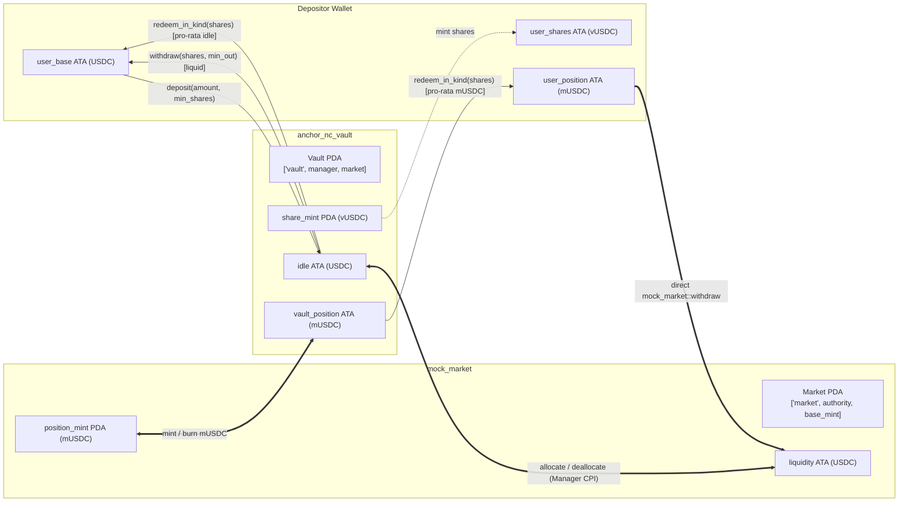

[README.md](https://github.com/user-attachments/files/34517485/README.md)
# Solana Vault, Timed Conditional Escrow & Non-Custodial In-Kind Share Vault


-brightgreen)

> **Turbin3 Q4 2026 Builders Cohort — Week 2 Assignment (Vault & Escrow)**  
> End-to-end implementation of **all core tasks (Tasks 1–3)**, the **Timed & Conditional Escrow Extension (Task 4)**, and the **Non-Custodial In-Kind Share Vault Advanced Extension (Task 5)** in **Anchor 1.2.2**, verified by **19 TypeScript + LiteSVM integration tests** executing directly against compiled SBF binaries in under **1 second**.

---

## Table of Contents

1. [Assignment Coverage Summary](#1-assignment-coverage-summary)
2. [Verified Test Run & Screenshots (19/19 Passing)](#2-verified-test-run--screenshots-1919-passing)
3. [Tech Stack & Program IDs](#3-tech-stack--program-ids)
4. [Complete Repository Layout](#4-complete-repository-layout)
5. [Program 1 — Native SOL Vault (`anchor-vault`)](#5-program-1--native-sol-vault-anchor-vault)
   - [5.1 PDA Derivations & Account Topology](#51-pda-derivations--account-topology)
   - [5.2 State Layout (`VaultState`)](#52-state-layout-vaultstate)
   - [5.3 Instruction-by-Instruction Specification](#53-instruction-by-instruction-specification)
   - [5.4 Error Codes & Security Invariants](#54-error-codes--security-invariants)
6. [Program 2 — Timed & Conditional SPL Token Escrow (`anchor-escrow`)](#6-program-2--timed--conditional-spl-token-escrow-anchor-escrow)
   - [6.1 PDA Derivations & Byte-Level State Layout](#61-pda-derivations--byte-level-state-layout)
   - [6.2 State Machine & Settlement Sequence](#62-state-machine--settlement-sequence)
   - [6.3 `Clock` Sysvar Time Window Mechanics](#63-clock-sysvar-time-window-mechanics)
   - [6.4 Dual-Mode Verifier Condition (`confirm_delivery` + Inline Co-Signature)](#64-dual-mode-verifier-condition-confirm_delivery--inline-co-signature)
   - [6.5 Instruction-by-Instruction Specification](#65-instruction-by-instruction-specification)
   - [6.6 Complete Error Code Reference](#66-complete-error-code-reference)
   - [6.7 Protocol Security & Liveness Proofs](#67-protocol-security--liveness-proofs)
7. [Program 3 — Non-Custodial Share Vault with In-Kind Market Redemption (`anchor-nc-vault`)](#7-program-3--non-custodial-share-vault-with-in-kind-market-redemption-anchor-nc-vault)
   - [7.1 Problem Statement: The 100%-Utilization Liquidity Trap](#71-problem-statement-the-100-utilization-liquidity-trap)
   - [7.2 Multi-Program Architecture (`anchor-nc-vault` + `mock-market`)](#72-multi-program-architecture-anchor-nc-vault--mock-market)
   - [7.3 PDA & Associated Token Account Topology](#73-pda--associated-token-account-topology)
   - [7.4 Share Pricing, NAV & Pro-Rata In-Kind Math](#74-share-pricing-nav--pro-rata-in-kind-math)
   - [7.5 Step-by-Step Zero-Liquidity Exit Walkthrough](#75-step-by-step-zero-liquidity-exit-walkthrough)
   - [7.6 Instruction & Error Reference](#76-instruction--error-reference)
   - [7.7 Non-Custodial Guarantees](#77-non-custodial-guarantees)
8. [TypeScript + LiteSVM Testing Architecture](#8-typescript--litesvm-testing-architecture)
   - [8.1 How the Anchor <-> LiteSVM Harness Works (`tests/utils.ts`)](#81-how-the-anchor---litesvm-harness-works-testsutilsts)
   - [8.2 Complete Test Case Breakdown & Execution Metrics](#82-complete-test-case-breakdown--execution-metrics)
9. [Build, Installation & Reproduction Guide](#9-build-installation--reproduction-guide)
10. [Real-World DeFi Applications](#10-real-world-defi-applications)

---

## 1. Assignment Coverage Summary

| # | Assignment Prompt | Implementation Details | Location |
| :-: | :--- | :--- | :--- |
| **1** | Write the **Vault** program including `withdraw` and `close` instructions | `initialize`, `deposit`, `withdraw` (retaining rent-exempt minimum), and `close` (draining all lamports + closing `VaultState` PDA with full rent refund to user) | [`./anchor-vault`](./anchor-vault) |
| **2** | Write the **Escrow** program with all instructions (`make`, `take`, `refund`, `update`) | SPL Token / Token-2022 atomic swap escrow with `make`, `take` (with front-running slippage guard), `refund`, and `update` | [`./anchor-escrow`](./anchor-escrow) |
| **3** | Write tests covering all instructions in **TypeScript** using **LiteSVM** | 19 integration tests across 3 suites testing every happy path, boundary condition, access-control check, `Clock` warp, and zero-liquidity stress path | `anchor-*/tests/*.ts` |
| **4** | **Extension Challenge:** Upgrade Escrow to run on a **timed mechanism** with a **condition of choice** using the `Clock` sysvar | Enforces `[unlock_at, expires_at)` via `Clock::get()?.unix_timestamp`, permissionless post-expiry crank refunds, and dual-mode **Verifier Delivery Confirmation (`confirm_delivery`) / Atomic Co-Signature** | [`./anchor-escrow`](./anchor-escrow) |
| **5** | **Advanced Extension Challenge:** Design a **non-custodial vault** where users can **redeem vault positions in kind** (even with zero available liquidity) and **exit anytime** | Share-tokenized vault (`anchor-nc-vault`) + lending market (`mock-market`) with manager-restricted CPI rebalancing (`allocate`/`deallocate`), liquid `withdraw`, and unstoppable `redeem_in_kind` | [`./anchor-nc-vault`](./anchor-nc-vault) |

---

## 2. Verified Test Run & Screenshots (19/19 Passing)

All three workspaces execute back-to-back via [`./run-all-tests.sh`](./run-all-tests.sh) in **847ms total VM execution time** (`205ms` + `342ms` + `300ms`) with **19 passing tests and 0 failures**:

### Terminal Screenshots


### Exact Terminal Output

```text
$ cd "/mnt/c/Users/acer/Downloads/Vault and Escrow"
$ bash ./run-all-tests.sh

========================================================================
 Running TypeScript + LiteSVM tests: anchor-vault
========================================================================


  anchor-vault (TypeScript + LiteSVM)
    ✔ initializes VaultState PDA and funds a rent-exempt Vault PDA
    ✔ rejects duplicate initialization for the same user
    ✔ deposits SOL across multiple transactions and tracks balances accurately
    ✔ rejects zero-amount deposit and deposits before initialization
    ✔ withdraws partial and full deposits while preserving the rent-exempt reserve
    ✔ rejects zero-amount withdrawals and withdrawals exceeding available funds
    ✔ prevents an attacker from withdrawing from another user's vault
    ✔ closes the vault, drains all lamports + rent to user, and allows re-initialization


  8 passing (205ms)


========================================================================
 Running TypeScript + LiteSVM tests: anchor-escrow
========================================================================


  anchor-escrow: make / take / refund / update + Timed Conditional Escrow (TypeScript + LiteSVM)
    ✔ make: creates Escrow PDA, locks Mint A in vault, and validates inputs (78ms)
    ✔ take: atomically swaps Mint A & Mint B and closes vault + escrow (47ms)
    ✔ update: lets maker revise terms and protects taker from front-running (45ms)
    ✔ refund: allows maker to cancel anytime on unconditional escrow, blocks strangers before expiry
    ✔ timed escrow (Clock sysvar): enforces unlock cliff, blocks expired takes, and allows permissionless crank refund (40ms)
    ✔ conditional timed escrow (Mode A — confirm_delivery): requires verifier attestation, blocks maker rugging, and settles in window (44ms)
    ✔ conditional timed escrow (Mode B — inline verifier co-signature & post-expiry liveness): supports single-tx co-sign AND recovery after expiry (47ms)


  7 passing (342ms)


========================================================================
 Running TypeScript + LiteSVM tests: anchor-nc-vault
========================================================================


  anchor-nc-vault: Non-Custodial Share Vault with In-Kind Market Redemption (TypeScript + LiteSVM)
    ✔ initializes market & vault and mints pro-rata shares on deposit with slippage protection (92ms)
    ✔ allows manager to rebalance (allocate/deallocate) strictly within vault-owned accounts and supports liquid withdraw (74ms)
    ✔ redeem_in_kind: lets users exit ANYTIME for underlying market positions even when BOTH vault and market have ZERO liquidity (71ms)
    ✔ redeem_in_kind: distributes exact pro-rata slice of BOTH idle liquidity and market positions (including yield) (55ms)


  4 passing (300ms)


All Vault, Timed Conditional Escrow, and Non-Custodial Vault test suites passed!
```

### Suite Execution Summary

| Test Suite | Target SBF Binary(s) | Passing Tests | Execution Time |
| :--- | :--- | :---: | :---: |
| `anchor-vault` | `anchor_vault.so` (`153 KB`) | `8 / 8` | `205 ms` |
| `anchor-escrow` | `anchor_escrow.so` (`268 KB`) | `7 / 7` | `342 ms` |
| `anchor-nc-vault` | `anchor_nc_vault.so` (`316 KB`) + `mock_market.so` (`238 KB`) | `4 / 4` | `300 ms` |
| **Total** | **4 SBF Programs** | **19 / 19** | **847 ms** |

---

## 3. Tech Stack & Program IDs

| Component | Package / Tool | Version | Role |
| :--- | :--- | :--- | :--- |
| On-Chain Framework | `anchor-lang` / `anchor-spl` | `1.2.2` | Account validation, PDA derivation,IDL generation, Token Interface CPIs |
| Compiler Toolchain | `rustc` / `cargo-build-sbf` | `1.89.0` / `4.4.0` (`v0` SBF) | Compiles Rust crates into deployable `.so` eBPF/SBF programs |
| In-Process SVM | `litesvm` (npm) | `^1.6.2` | Executes SBF binaries directly in Node.js with `Clock` sysvar control |
| Client SDK | `@anchor-lang/core` + `@solana/web3.js` | `^1.2.2` / `^1.98.4` | Encodes instruction data, resolves PDAs, decodes Borsh state |
| Token Helpers | `@solana/spl-token` + `@solana/kit` | `^0.4.14` / `^8.0.0` | Mint/ATA setup, token balance decoding, wire transaction decoding |
| Test Runner | `ts-mocha` + `mocha` + `chai` | `^10.0.0` / `^4.3.4` | TypeScript test execution and assertion library |

### Program IDs

| Workspace | Program Name | Program ID (`declare_id!`) |
| :--- | :--- | :--- |
| `anchor-vault` | `anchor_vault` | `22PpE5zFUcwCxAWNNxJhiNJddUtqqBCBZMjAZBc3T7QN` |
| `anchor-escrow` | `anchor_escrow` | `BS4oJrc7JBdHoijrqa8nsdF8T3x9EsNxzBdhpQCinkpB` |
| `anchor-nc-vault` | `anchor_nc_vault` | `BwJB4EebGWmtBBJiS1PQit6Hn1ymxeD7WPsdmrScZuzX` |
| `anchor-nc-vault` | `mock_market` | `Co9dv4kQePJoHZyLtyXnbr43sBv4hAdZgF7bFm1xeWhk` |

---

## 4. Complete Repository Layout

```text
Vault-and-Escrow/
├── README.md                                        # Full technical documentation
├── run-all-tests.sh                                 # One-command runner for all 3 test suites
├── .gitignore
├── docs/
│   └── screenshots/
│       ├── tests-passing-1.png                      # Verified test run screenshot (Part 1)
│       └── tests-passing-2.png                      # Verified test run screenshot (Part 2)
│
├── anchor-vault/                                    # Workspace 1: Native SOL Vault
│   ├── Anchor.toml
│   ├── Cargo.toml / rust-toolchain.toml
│   ├── package.json / tsconfig.json
│   ├── README.md
│   ├── programs/anchor-vault/
│   │   ├── Cargo.toml
│   │   └── src/
│   │       ├── lib.rs                               # Program entrypoint
│   │       ├── constants.rs                         # STATE_SEED, VAULT_SEED
│   │       ├── error.rs                             # VaultError enum
│   │       ├── state.rs                             # VaultState account struct
│   │       ├── instructions.rs
│   │       └── instructions/
│   │           ├── initialize.rs                    # Init VaultState + fund rent-exempt Vault
│   │           ├── deposit.rs                       # User -> Vault lamport transfer
│   │           ├── withdraw.rs                      # Vault -> User lamport transfer (PDA-signed)
│   │           └── close.rs                         # Drain Vault + close VaultState
│   └── tests/
│       ├── utils.ts                                 # LiteSVM + Anchor TS test harness
│       └── anchor-vault.ts                          # 8 integration tests
│
├── anchor-escrow/                                   # Workspace 2: Timed & Conditional SPL Escrow
│   ├── Anchor.toml
│   ├── Cargo.toml / rust-toolchain.toml
│   ├── package.json / tsconfig.json
│   ├── README.md
│   ├── programs/anchor-escrow/
│   │   ├── Cargo.toml
│   │   └── src/
│   │       ├── lib.rs                               # make, confirm_delivery, take, refund, update
│   │       ├── constants.rs                         # ESCROW_SEED, MAX_DURATION, NO_EXPIRY
│   │       ├── error.rs                             # EscrowError enum (13 variants)
│   │       ├── state.rs                             # Escrow struct + Clock window math
│   │       ├── instructions.rs
│   │       └── instructions/
│   │           ├── make.rs                          # Create Escrow + Vault ATA + lock Mint A
│   │           ├── confirm_delivery.rs              # Mode A verifier on-chain confirmation
│   │           ├── take.rs                          # Atomic swap + Mode B inline co-sign + close
│   │           ├── update.rs                        # Maker price / window / verifier update
│   │           └── refund.rs                        # Maker cancel & post-expiry crank refund
│   └── tests/
│       ├── utils.ts
│       └── anchor-escrow.ts                         # 7 integration tests
│
└── anchor-nc-vault/                                 # Workspace 3: Non-Custodial Share Vault + Market
    ├── Anchor.toml
    ├── Cargo.toml / rust-toolchain.toml
    ├── package.json / tsconfig.json
    ├── README.md
    ├── programs/
    │   ├── anchor-nc-vault/
    │   │   ├── Cargo.toml                           # Depends on mock-market with features = ["cpi"]
    │   │   └── src/
    │   │       ├── lib.rs                           # initialize, deposit, withdraw, redeem_in_kind, allocate, deallocate
    │   │       ├── constants.rs                     # VAULT_SEED, SHARES_SEED
    │   │       ├── error.rs                         # VaultError enum (6 variants)
    │   │       ├── state.rs                         # Vault struct + u128 NAV & pro-rata math
    │   │       ├── instructions.rs
    │   │       └── instructions/
    │   │           ├── initialize.rs                # Bind vault to market, create share_mint & ATAs
    │   │           ├── deposit.rs                   # Deposit base_mint -> mint pro-rata shares
    │   │           ├── withdraw.rs                  # Burn shares -> withdraw liquid base_mint at NAV
    │   │           ├── redeem_in_kind.rs            # Burn shares -> receive pro-rata idle + market position
    │   │           └── rebalance.rs                 # Manager CPI allocate / deallocate
    │   └── mock-market/
    │       ├── Cargo.toml
    │       └── src/
    │           ├── lib.rs                           # initialize, supply, withdraw, borrow, repay
    │           ├── constants.rs                     # MARKET_SEED, POSITION_MINT_SEED
    │           ├── error.rs                         # MarketError enum
    │           ├── state.rs                         # Market struct
    │           ├── instructions.rs
    │           └── instructions/
    │               ├── initialize.rs
    │               ├── supply.rs
    │               ├── withdraw.rs
    │               ├── borrow.rs
    │               └── repay.rs
    └── tests/
        ├── utils.ts
        └── anchor-nc-vault.ts                       # 4 integration tests
```

---

## 5. Program 1 — Native SOL Vault (`anchor-vault`)

### 5.1 PDA Derivations & Account Topology

| Account | Type | Owner | Seeds | Space | Purpose |
| :--- | :--- | :--- | :--- | :---: | :--- |
| `vault_state` | `Account<'info, VaultState>` | `anchor_vault` | `[b"state", user.key().as_ref()]` | `10 B` (`8 + 2`) | Stores canonical bumps (`vault_bump`, `state_bump`) |
| `vault` | `SystemAccount<'info>` | `SystemProgram` | `[b"vault", user.key().as_ref()]` | `0 B` | Holds the user's native SOL deposits + rent-exempt reserve |



### 5.2 State Layout (`VaultState`)

```rust
#[account]
#[derive(InitSpace)]
pub struct VaultState {
    pub vault_bump: u8, // 1 byte
    pub state_bump: u8, // 1 byte
}
// Total account size = 8 (Anchor discriminator) + 2 = 10 bytes
```

### 5.3 Instruction-by-Instruction Specification

1. **`initialize(ctx: Context<Initialize>)`**
   - Allocates `vault_state` (`init, payer = user, space = 10`).
   - Queries `Rent::get()?.minimum_balance(self.vault.data_len())` (`890,880` lamports for a `0`-byte account) and transfers it from `user` to `vault` via `system_program::transfer` so the vault PDA immediately exists on-chain as a rent-exempt system account.
   - Persists `bumps.vault` and `bumps.vault_state` in `vault_state`.
2. **`deposit(ctx: Context<Deposit>, amount: u64)`**
   - Enforces `amount > 0` (`VaultError::InvalidAmount`).
   - Validates `vault_state` (`bump = vault_state.state_bump`) and `vault` (`bump = vault_state.vault_bump`).
   - Transfers `amount` lamports from `user` to `vault` via `system_program::transfer`.
3. **`withdraw(ctx: Context<Withdraw>, amount: u64)`**
   - Enforces `amount > 0` (`VaultError::InvalidAmount`).
   - Computes withdrawable balance excluding the rent-exempt floor:
     ```rust
     let rent_exempt = Rent::get()?.minimum_balance(self.vault.data_len());
     let available = self.vault.lamports().saturating_sub(rent_exempt);
     require!(amount <= available, VaultError::InsufficientFunds);
     ```
   - Constructs PDA signer seeds `&[&[b"vault", user.key().as_ref(), &[vault_state.vault_bump]]]` and invokes `system_program::transfer` via `CpiContext::new_with_signer`.
4. **`close(ctx: Context<Close>)`**
   - Transfers the **entire** `self.vault.lamports()` balance (all remaining deposits + the `890,880`-lamport rent reserve) back to `user` using PDA signer seeds, reducing `vault` to `0` lamports (garbage-collected by the runtime).
   - Anchor's `#[account(mut, close = user, ...)]` constraint zeroes `vault_state` and refunds its rent lamports to `user`.

### 5.4 Error Codes & Security Invariants

| Error Code | Variant | Trigger |
| :---: | :--- | :--- |
| `6000` | `InvalidAmount` | `deposit(0)` or `withdraw(0)` |
| `6001` | `InsufficientFunds` | `amount > vault.lamports() - rent_exempt` |
| `2006` *(Anchor)* | `ConstraintSeeds` | Attacker attempts to pass another user's `vault` or `vault_state` PDA |
| `3012` *(Anchor)* | `AccountNotInitialized` | Calling `deposit`, `withdraw`, or `close` before `initialize` (or after `close`) |

---

## 6. Program 2 — Timed & Conditional SPL Token Escrow (`anchor-escrow`)

### 6.1 PDA Derivations & Byte-Level State Layout

- **`escrow` PDA:** `seeds = [b"escrow", maker.key().as_ref(), seed.to_le_bytes().as_ref()]`
- **`vault` ATA:** Associated Token Account of `mint_a` with `authority = escrow` (`allowOwnerOffCurve = true`)

```rust
#[account]
#[derive(InitSpace)]
pub struct Escrow {
    pub seed: u64,                  //  8 bytes — maker-chosen identifier
    pub maker: Pubkey,              // 32 bytes — offer creator & rent recipient
    pub mint_a: Pubkey,             // 32 bytes — offered token mint
    pub mint_b: Pubkey,             // 32 bytes — requested token mint
    pub receive: u64,               //  8 bytes — requested amount of mint_b
    pub created_at: i64,            //  8 bytes — Clock unix_timestamp at creation
    pub unlock_at: i64,             //  8 bytes — earliest take timestamp (0 = immediate)
    pub expires_at: i64,            //  8 bytes — deadline timestamp (0 = no expiry)
    pub verifier: Option<Pubkey>,   // 33 bytes — optional condition authority (1 + 32)
    pub delivery_confirmed: bool,   //  1 byte  — true once condition is attested
    pub confirmed_at: i64,          //  8 bytes — Clock timestamp of confirmation
    pub bump: u8,                   //  1 byte  — canonical PDA bump
}
// Total space = 8 (discriminator) + 147 = 155 bytes
```

### 6.2 State Machine & Settlement Sequence



### 6.3 `Clock` Sysvar Time Window Mechanics

`Escrow::compute_window(now, unlock_delay, duration, has_verifier)` enforces:
1. `unlock_delay >= 0` (`InvalidTimeWindow`). If `0`, `unlock_at = 0` (immediately unlocked); otherwise `unlock_at = now.checked_add(unlock_delay)`.
2. `0 <= duration <= MAX_DURATION` (`365 * 24 * 60 * 60 = 31,536,000` seconds; `InvalidDuration`). If `0`, `expires_at = NO_EXPIRY (0)`; otherwise `expires_at = now.checked_add(duration)`.
3. If `has_verifier == true`, `duration > 0` is mandatory (`VerifierRequiresExpiry`).
4. If both `unlock_at > 0` and `expires_at > 0`, `expires_at > unlock_at` is mandatory (`InvalidTimeWindow`).

At runtime:
- `is_locked(now)` is `self.unlock_at > 0 && now < self.unlock_at`.
- `is_expired(now)` is `self.expires_at != 0 && now >= self.expires_at`.

### 6.4 Dual-Mode Verifier Condition (`confirm_delivery` + Inline Co-Signature)

Task 4 asks to upgrade the escrow to a timed mechanism with a condition of choice (`signature, delivery confirmation, etc.`). `anchor-escrow` supports **both** seamlessly through `verifier: Option<Pubkey>`:

- **Unconditional Offer (`verifier: None`):** `delivery_confirmed` initializes to `true`; any taker can settle inside `[unlock_at, expires_at)`.
- **Mode A — On-Chain Delivery Confirmation (`confirm_delivery`):** When physical goods, freelance milestones, or off-chain services are delivered, the designated `verifier` signs `confirm_delivery` prior to `expires_at`. Once confirmed on-chain, the taker can call `take` independently without needing the verifier online at settlement time.
- **Mode B — Inline Atomic Co-Signature (`take` with `verifier: Some(signer)`):** For RFQ quotes, compliance-gated swaps, or instant oracle attestations, `verifier` co-signs the `take` transaction directly alongside `taker`, settling in **one transaction** without calling `confirm_delivery` first.

### 6.5 Instruction-by-Instruction Specification

| Instruction | Key Accounts | Validation & Effects |
| :--- | :--- | :--- |
| `make` | `maker` (signer), `mint_a`, `mint_b`, `maker_ata_a`, `escrow` (init), `vault` (init ATA) | Checks `deposit > 0`, `receive > 0`, `mint_a != mint_b`, and valid `Clock` window; initializes `Escrow` and CPIs `transfer_checked` (`deposit` of `mint_a` -> `vault`). |
| `confirm_delivery` | `verifier` (signer), `escrow` (mut) | Requires `escrow.verifier == Some(verifier.key())`, `!delivery_confirmed`, and `!is_expired(now)`. Sets `delivery_confirmed = true` and `confirmed_at = now`. |
| `take` | `taker` (signer), `maker` (mut), `verifier` (`Option<Signer>`), `mint_a`, `mint_b`, `taker_ata_a` (`init_if_needed`), `taker_ata_b`, `maker_ata_b` (`init_if_needed`), `escrow` (`close = maker`), `vault` (mut) | Verifies `!is_locked(now)`, `!is_expired(now)`, verifier condition satisfied, and `escrow.receive == expected_receive`. Transfers `receive` of `mint_b` (`taker` -> `maker`), transfers `vault.amount` of `mint_a` (`vault` -> `taker` via PDA seeds), closes `vault` & `escrow` to `maker`. |
| `update` | `maker` (signer), `escrow` (mut, `has_one = maker`) | Rejects if `verifier.is_some() && delivery_confirmed` (`AlreadyConfirmed`). Updates `receive`, recomputes `unlock_at`/`expires_at` from current `Clock`, and updates `verifier`. |
| `refund` | `caller` (signer), `maker` (mut), `mint_a`, `maker_ata_a` (`init_if_needed`), `escrow` (`close = maker`), `vault` (mut) | If `caller == maker`: allowed unless `verifier.is_some() && delivery_confirmed && !is_expired(now)`. If `caller != maker`: requires `is_expired(now)`. Transfers `vault.amount` back to `maker_ata_a` and closes `vault` + `escrow` to `maker`. |

### 6.6 Complete Error Code Reference

| Code | Variant | Description |
| :---: | :--- | :--- |
| `6000` | `InvalidAmount` | `deposit == 0`, `receive == 0`, or `new_receive == 0` |
| `6001` | `InvalidDuration` | `duration < 0` or `duration > MAX_DURATION` (1 year) |
| `6002` | `InvalidTimeWindow` | `unlock_delay < 0` or `expires_at <= unlock_at` |
| `6003` | `VerifierRequiresExpiry` | `verifier` is `Some(...)` while `duration == 0` |
| `6004` | `EscrowLocked` | `take` called while `Clock.unix_timestamp < unlock_at` |
| `6005` | `EscrowExpired` | `take` or `confirm_delivery` called at/after `expires_at` |
| `6006` | `NotExpired` | Non-maker called `refund` before `expires_at` |
| `6007` | `ConditionNotMet` | `take` called on unconfirmed conditional escrow without `verifier` co-signer |
| `6008` | `UnauthorizedVerifier` | Signer pubkey does not match `escrow.verifier` |
| `6009` | `AlreadyConfirmed` | Duplicate `confirm_delivery`, or maker tried to `update` after confirmation |
| `6010` | `DeliveryConfirmedActive` | Maker tried to `refund` an active confirmed escrow before `expires_at` |
| `6011` | `ReceiveMismatch` | `escrow.receive != expected_receive` (front-run / stale terms guard) |
| `6012` | `SameMint` | `mint_a == mint_b` |
| `6013` | `Overflow` | Checked timestamp addition overflow |

### 6.7 Protocol Security & Liveness Proofs

1. **Front-Run Immunity:** `take` commits to `expected_receive`, aborting if `maker` front-runs with `update`.
2. **Counterparty Fairness Post-Confirmation:** Once `verifier` confirms delivery, `maker` can neither hike `receive` (`update` -> `AlreadyConfirmed`) nor claw back `mint_a` (`refund` -> `DeliveryConfirmedActive`) before `expires_at`.
3. **Deadlock-Free Liveness:** Because `VerifierRequiresExpiry` guarantees a finite `expires_at` whenever a verifier is attached, even if the taker disappears permanently after `confirm_delivery`, `maker` (or any crank) recovers 100% of `mint_a` and account rent once `now >= expires_at`.
4. **Zero Crank Theft Surface:** On expired escrows, `caller` pays any temporary tx fee while `maker_ata_a` (`associated_token::authority = maker`) and `close = maker` hard-route every token and rent lamport strictly to `maker`.

---

## 7. Program 3 — Non-Custodial Share Vault with In-Kind Market Redemption (`anchor-nc-vault`)

### 7.1 Problem Statement: The 100%-Utilization Liquidity Trap

In DeFi yield vaults (lending aggregators, curated money-market vaults), capital is deployed into underlying lending pools where borrowers take loans. When market utilization hits **100%**, idle liquidity drops to **zero** in both the vault **and** the lending market:
- Standard `withdraw(USDC)` instructions revert (`InsufficientLiquidity`).
- Even manager `deallocate` calls revert because the lending market has no idle `USDC` to return.
- Custodial or queue-based vaults freeze user exits indefinitely.

**Design Goal (Task 5):** Build a strictly **non-custodial** vault where users hold tokenized equity (`share_mint`) and can **exit at any block without permission**, redeeming their shares **in kind** for the vault's underlying market position tokens (`position_mint`) even when available liquidity is zero everywhere.

### 7.2 Multi-Program Architecture (`anchor-nc-vault` + `mock-market`)



### 7.3 PDA & Associated Token Account Topology

| Program | Account | Seeds / Derivation | Authority | Holds / Stores |
| :--- | :--- | :--- | :--- | :--- |
| `mock_market` | `market` | `[b"market", authority, base_mint]` | `authority` | `base_mint`, `position_mint`, `borrowed`, bumps |
| `mock_market` | `position_mint` | `[b"position", market]` | `market` PDA | 1:1 market receipt token (`mUSDC`) |
| `mock_market` | `liquidity` | ATA(`base_mint`, `market`) | `market` PDA | Idle unborrowed `base_mint` in the pool |
| `anchor_nc_vault` | `vault` | `[b"vault", manager, market]` | `vault` PDA | `manager`, `market`, `base_mint`, `position_mint`, `share_mint`, bumps |
| `anchor_nc_vault` | `share_mint` | `[b"shares", vault]` | `vault` PDA | Transferable vault equity shares (`vUSDC`) |
| `anchor_nc_vault` | `idle` | ATA(`base_mint`, `vault`) | `vault` PDA | Undeployed liquid `base_mint` (`USDC`) |
| `anchor_nc_vault` | `vault_position` | ATA(`position_mint`, `vault`) | `vault` PDA | Underlying `mock_market` receipt tokens (`mUSDC`) |

### 7.4 Share Pricing, NAV & Pro-Rata In-Kind Math

Implemented in [`anchor-nc-vault/src/state.rs`](./anchor-nc-vault/programs/anchor-nc-vault/src/state.rs) using checked `u128` multiplication before division:

| Operation | Formula | Rounding Direction |
| :--- | :--- | :--- |
| **Vault NAV** | `total_assets = idle.amount + vault_position.amount` | Exact `u64::checked_add` |
| **Initial `deposit`** (`supply == 0`) | `shares = amount` | Exact `1:1` |
| **Subsequent `deposit`** | `shares = (amount as u128 * supply as u128) / total_assets as u128` | Floor (protects existing share holders) |
| **Liquid `withdraw`** | `out = (total_assets as u128 * shares as u128) / supply as u128` | Floor (protects remaining share holders) |
| **`redeem_in_kind` (Base leg)** | `base_out = (idle.amount as u128 * shares as u128) / supply as u128` | Floor |
| **`redeem_in_kind` (Market leg)** | `position_out = (vault_position.amount as u128 * shares as u128) / supply as u128` | Floor |

Notice a key property of `redeem_in_kind`: because **both** `idle` and `vault_position` are sliced by the exact same ratio `shares / supply`, the vault's asset composition (`idle : vault_position`) and NAV-per-share for remaining depositors stay completely invariant before and after any user's in-kind exit!

### 7.5 Step-by-Step Zero-Liquidity Exit Walkthrough

Verified in test #3 of [`anchor-nc-vault.ts`](./anchor-nc-vault/tests/anchor-nc-vault.ts):

| Step | Action | Vault `idle` (`USDC`) | Vault `vault_position` (`mUSDC`) | Market `liquidity` (`USDC`) | Alice Wallet |
| :---: | :--- | :---: | :---: | :---: | :--- |
| 1 | Alice & Bob each `deposit(1,000 USDC)` | `2,000` | `0` | `0` | `1,000 vUSDC` |
| 2 | Manager calls `allocate(2,000 USDC)` | **`0`** | `2,000` | `2,000` | `1,000 vUSDC` |
| 3 | Borrower calls `mock_market::borrow(2,000 USDC)` | **`0`** | `2,000` | **`0` (100% utilized!)** | `1,000 vUSDC` |
| 4 | Alice tries `withdraw(1,000)` & Manager tries `deallocate(1,000)` | Both revert with `InsufficientLiquidity` | `2,000` | **`0`** | `1,000 vUSDC` |
| 5 | **Alice calls `redeem_in_kind(1,000 vUSDC)`** | **`0`** | `1,000` | **`0`** | **`0 vUSDC`, `1,000 mUSDC`** |
| 6 | Borrower calls `mock_market::repay(2,000 USDC)` | `0` | `1,000` | `2,000` | `1,000 mUSDC` |
| 7 | **Alice calls `mock_market::withdraw(1,000 mUSDC)` directly** | `0` | `1,000` | `1,000` | **`+1,000 USDC`, `0 mUSDC`** |

### 7.6 Instruction & Error Reference

#### `anchor-nc-vault` Custom Errors
| Code | Variant | Trigger |
| :---: | :--- | :--- |
| `6000` | `InvalidAmount` | `amount == 0` or `shares == 0` |
| `6001` | `ZeroShares` | Deposit rounds down to `0` shares |
| `6002` | `SlippageExceeded` | `shares < min_shares` on `deposit`, or `out < min_out` on `withdraw` |
| `6003` | `InsufficientLiquidity` | `idle.amount < out` during liquid `withdraw` (user can call `redeem_in_kind` instead) |
| `6004` | `NothingToRedeem` | Share supply is `0` or pro-rata outputs are both `0` |
| `6005` | `MathOverflow` | Checked arithmetic overflow |

#### `mock-market` Custom Errors
| Code | Variant | Trigger |
| :---: | :--- | :--- |
| `6000` | `InvalidAmount` | `supply(0)`, `withdraw(0)`, `borrow(0)`, or `repay(0)` |
| `6001` | `InsufficientLiquidity` | `liquidity.amount < amount` on `withdraw` or `borrow` |

### 7.7 Non-Custodial Guarantees

1. **Manager Cannot Touch User Principal or Yield:** `Rebalance` enforces `associated_token::authority = vault` on both `idle` and `vault_position`, and `has_one = market` on `vault`. The manager can only shift vault liquidity between `idle` and the single whitelisted `mock_market` — never to any external account.
2. **Unstoppable User Exit:** `redeem_in_kind` has **no** CPI to `mock_market`, **no** liquidity check, **no** oracle dependency, and **no** manager signature requirement — it performs only direct SPL token transfers signed by the `vault` PDA when a user burns their own `share_mint` tokens.
3. **Composable Equity & Positions:** Both `share_mint` (`vUSDC`) and `position_mint` (`mUSDC`) are standard SPL tokens held directly in user ATAs.

---

## 8. TypeScript + LiteSVM Testing Architecture

### 8.1 How the Anchor <-> LiteSVM Harness Works (`tests/utils.ts`)

`litesvm` (`v1.6.2`) exposes a blazing-fast native Rust Solana VM inside Node.js using `@solana/kit` wire types, while Anchor's TypeScript client (`@anchor-lang/core` `v1.2.2`) builds instructions and decodes accounts using `@solana/web3.js` v1 types.

Our shared [`utils.ts`](./anchor-vault/tests/utils.ts) bridges both cleanly in ~250 lines:
- **Instruction Encoding & Account Decoding via Anchor:** `loadProgram<T>(idl)` instantiates a typed `anchor.Program<T>` so tests use idiomatic `program.methods.<ix>(...).accountsPartial({...}).instruction()` and `program.coder.accounts.decode(...)`.
- **Zero-Validator Execution via LiteSVM:** `Env.send(ixs, signers)` signs a legacy `Transaction`, serializes wire bytes, decodes into `@solana/kit` via `getTransactionDecoder()`, executes synchronously on `LiteSVM.sendTransaction(...)`, and calls `svm.expireBlockhash()` so back-to-back identical test transactions are never dropped as duplicates.
- **Deterministic `Clock` Time-Travel:** `env.warp(seconds)` mutates `Clock.unixTimestamp` via `svm.getClock()` / `svm.setClock(c)`, testing 10-minute unlock cliffs and 1-hour expirations instantaneously without sleeping.

### 8.2 Complete Test Case Breakdown & Execution Metrics

| # | Suite | Test Case | Time | Verified Assertions |
| :-: | :--- | :--- | :---: | :--- |
| 1 | `anchor-vault` | `initializes VaultState PDA and funds a rent-exempt Vault PDA` | `<35ms` | Owner check, canonical bumps, exact `rentExempt(0)` balance |
| 2 | `anchor-vault` | `rejects duplicate initialization for the same user` | `<35ms` | Re-init failure on existing `VaultState` PDA |
| 3 | `anchor-vault` | `deposits SOL across multiple transactions and tracks balances accurately` | `<35ms` | Multi-tx deposit sum + exact `2 * TX_FEE` user deduction |
| 4 | `anchor-vault` | `rejects zero-amount deposit and deposits before initialization` | `<35ms` | `AccountNotInitialized` & `InvalidAmount` |
| 5 | `anchor-vault` | `withdraws partial and full deposits while preserving the rent-exempt reserve` | `<35ms` | Partial + full withdraw leaving exact `rentExempt(0)` |
| 6 | `anchor-vault` | `rejects zero-amount withdrawals and withdrawals exceeding available funds` | `<35ms` | `InvalidAmount` & `InsufficientFunds` (`deposit + 1` lamport) |
| 7 | `anchor-vault` | `prevents an attacker from withdrawing from another user's vault` | `<35ms` | `ConstraintSeeds` when attacker passes victim PDAs |
| 8 | `anchor-vault` | `closes the vault, drains all lamports + rent to user, and allows re-initialization` | `<35ms` | `vault == 0`, `vaultState` closed, net delta `== -4 * TX_FEE`, re-init |
| 9 | `anchor-escrow` | `make: creates Escrow PDA, locks Mint A in vault, and validates inputs` | `78ms` | `InvalidAmount`, `SameMint`, `VerifierRequiresExpiry`, `InvalidTimeWindow`, `Clock` timestamps |
| 10 | `anchor-escrow` | `take: atomically swaps Mint A & Mint B and closes vault + escrow` | `47ms` | Token swap balances, account closure, maker SOL rent increase |
| 11 | `anchor-escrow` | `update: lets maker revise terms and protects taker from front-running` | `45ms` | Non-maker rejection, `ReceiveMismatch` on stale price, take at updated price |
| 12 | `anchor-escrow` | `refund: allows maker to cancel anytime on unconditional escrow, blocks strangers before expiry` | `<38ms` | `NotExpired` for stranger, full Mint A & rent return for maker |
| 13 | `anchor-escrow` | `timed escrow (Clock sysvar): enforces unlock cliff, blocks expired takes, and allows permissionless crank refund` | `40ms` | `warp(120)` -> `EscrowLocked`, `warp(3500)` -> `EscrowExpired`, crank `refund` -> maker receives 100% |
| 14 | `anchor-escrow` | `conditional timed escrow (Mode A — confirm_delivery): requires verifier attestation, blocks maker rugging, and settles in window` | `44ms` | `ConditionNotMet`, `UnauthorizedVerifier`, `confirm_delivery`, `AlreadyConfirmed`, `DeliveryConfirmedActive`, `take` |
| 15 | `anchor-escrow` | `conditional timed escrow (Mode B — inline verifier co-signature & post-expiry liveness): supports single-tx co-sign AND recovery after expiry` | `47ms` | Wrong co-signer rejected, atomic `[taker, verifier]` `take`, post-expiry maker refund after confirmation |
| 16 | `anchor-nc-vault` | `initializes market & vault and mints pro-rata shares on deposit with slippage protection` | `92ms` | Market + Vault PDAs, `InvalidAmount`, `SlippageExceeded`, 1:1 initial share minting |
| 17 | `anchor-nc-vault` | `allows manager to rebalance (allocate/deallocate) strictly within vault-owned accounts and supports liquid withdraw` | `74ms` | Non-manager rejected, `allocate`, `deallocate`, zero manager token balance, liquid `withdraw` |
| 18 | `anchor-nc-vault` | `redeem_in_kind: lets users exit ANYTIME for underlying market positions even when BOTH vault and market have ZERO liquidity` | `71ms` | 100% `allocate` + 100% `borrow`, `InsufficientLiquidity` on `withdraw`/`deallocate`, `redeem_in_kind` -> `repay` -> direct `mock_market::withdraw` |
| 19 | `anchor-nc-vault` | `redeem_in_kind: distributes exact pro-rata slice of BOTH idle liquidity and market positions (including yield)` | `55ms` | Mixed `600` idle (incl. `200` yield) + `1,600` market position -> 50% redemption yields `300 USDC + 800 mUSDC` |

---

## 9. Build, Installation & Reproduction Guide

### Prerequisites
- **OS:** Linux, macOS, or **WSL2 (Ubuntu)** on Windows *(required for Solana SBF tools and `litesvm` native Node.js binaries)*
- **Rust:** `1.89.0+` (`rustup`)
- **Solana CLI:** `cargo-build-sbf` (`solana-cli 4.x` / Agave)
- **Anchor CLI:** `1.2.2` (`avm install 1.2.2 && avm use 1.2.2`)
- **Node.js & Yarn:** Node `18+` (verified on `v24.22.0`) and `yarn` (`1.22+`)

### Quick Start — Run All Pre-Built Suites Immediately

```bash
git clone https://github.com/Detoxin01/Vault-and-Escrow.git
cd Vault-and-Escrow
bash ./run-all-tests.sh
```

### Rebuild SBF Binaries & IDLs From Scratch

```bash
# 1. Native SOL Vault
cd anchor-vault
anchor build --arch v0
yarn install && yarn test

# 2. Timed & Conditional SPL Escrow
cd ../anchor-escrow
anchor build --arch v0
yarn install && yarn test

# 3. Non-Custodial Share Vault + Underlying Lending Market
cd ../anchor-nc-vault
anchor build --arch v0
yarn install && yarn test
```

> **Note on `--arch v0`:** `cargo-build-sbf 4.4+` defaults to `sbpfv3` (`--arch v3`); passing `--arch v0` (or `ANCHOR_BUILD_SBF_ARCH=v0`) produces universal SBF binaries compatible with both LiteSVM and current Solana clusters.

---

## 10. Real-World DeFi Applications

1. **Commerce, Freelance & Supply-Chain Escrows (`anchor-escrow`):** Buyers lock stablecoins with a delivery deadline; a logistics oracle or marketplace arbiter calls `confirm_delivery` upon shipment verification (Mode A), protecting the seller from buyer cancellation while guaranteeing automatic buyer refund if delivery never occurs before `expires_at`.
2. **RFQ & Institutional OTC Settlement (`anchor-escrow`):** Market makers stream quotes off-chain and co-sign `take` atomically (Mode B) with a tight `expires_at` TTL and optional `unlock_at` vesting cliff, eliminating stale-quote sniping.
3. **Curated Non-Custodial Lending Vaults (`anchor-nc-vault`):** Risk curators dynamically allocate deposits across money markets without ever holding withdrawal custody, while institutional and retail depositors retain a mathematically guaranteed, permissionless `redeem_in_kind` exit even during 100%-utilization market crunches.

---

## License

MIT
